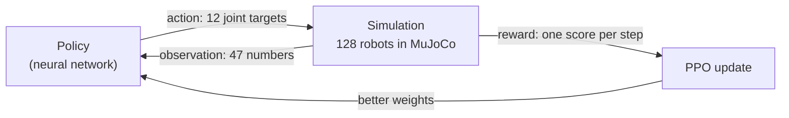

# How the RL walk is trained

The robot learns to walk by trial and error in simulation. Nothing tells it *how* to move its legs:
there is no ZMP planner and no recorded motion. A neural network picks the joint angles, a score says
how good the result was, and the network is adjusted to score higher. This is pure reinforcement
learning (RL) with the PPO algorithm.

Code: [`sim/rl_walk_env.py`](../sim/rl_walk_env.py) (the world and the score),
[`sim/rl_walk_train.py`](../sim/rl_walk_train.py) (the learning),
[`sim/rl_walk_play.py`](../sim/rl_walk_play.py) (testing and video).

## 1. The big picture



One loop, repeated about 6,000 times:

1. **Collect.** 128 simulated robots each take 256 steps with the current policy (32,768 samples, 5 s of walking each).
2. **Score.** Every step gets a reward.
3. **Update.** PPO changes the network a little so that actions that scored well become more likely.

After 200 million steps (about 46 days of simulated walking, 5.5 hours on the Mac) the result is `walk_v3`.

## 2. The policy: what goes in, what comes out

The policy runs 50 times per second (every 20 ms).

**Input: 47 numbers.** Everything in it can be measured on the real robot.

| Numbers | What | Real-robot source |
|---|---|---|
| 12 | joint angles, relative to the standing pose | servo encoders |
| 12 | joint speeds | servo encoders |
| 3 | direction of gravity in the body frame (which way is down) | IMU |
| 3 | rotation rate of the body | IMU gyro |
| 3 | the command: forward speed, sideways speed, turn rate | you / joystick |
| 2 | gait clock: sin and cos of a 0.7 s cycle | a timer |
| 12 | the action it chose last time | memory |

The policy does **not** see its own speed or position, because the real robot cannot measure them.

**Output: 12 numbers between −1 and 1**, one per joint. They are offsets from a standing pose with
slightly bent knees:

```
joint target = standing pose + scale × action
```

The scale is 0.5 rad (29°) for the pitch joints (hip, knee, ankle) and 0.25 rad (14°) for yaw and roll.
The servo's own position controller then moves the joint to the target.

**The network.** Two hidden layers of 256 neurons. A second network of the same size (the *critic*)
estimates how much reward is still to come; PPO needs it to judge whether an action was better than expected.

## 3. The reward: what "good walking" means

This is where the walking style is designed. Each step, the score is a weighted sum of 15 terms.

**Things to do (positive):**

| Term | Weight | Meaning |
|---|---|---|
| `track_lin` | 1.5 | move at the commanded forward / sideways speed |
| `track_yaw` | 0.75 | turn at the commanded rate |
| `feet_phase` | 1.5 | each foot is at the height the gait clock asks for |
| `alive` | 0.5 | not fallen |

`feet_phase` is what produces a stepping rhythm. The clock gives each foot a target height: on the
floor for 60 % of the cycle, then a smooth 30 mm arc for 40 %, with the right foot half a cycle after
the left. The reward says *when* and *how high* to lift, not which joints to use.

**Things to avoid (negative):**

| Term | Weight | Stops the robot from |
|---|---|---|
| `tilt` | −5 | leaning |
| `height` | −1500 | crouching (pelvis lower than when standing) |
| `bounce`, `wobble` | −0.5, −0.05 | bobbing up and down, rocking |
| `hip_pose` | −2 | turning its toes in or out |
| `foot_flat` | −2 | landing on the edge of the foot |
| `slip` | −0.5 | sliding a foot that is on the floor |
| `feet_close` | −10 | putting the feet closer than 8 cm (they would collide) |
| `torque` | −0.0005 | wasting motor effort |
| `action_rate` | −0.02 | jittering |
| `stand` | −0.5 | fidgeting when the command is "stand still" |

An episode ends when the robot falls or after 20 s. Falling loses all future reward, so staying up is
always the first thing learned.

## 4. Commands

Each robot gets a random command, replaced every 5 s:

- forward −0.1 … 0.3 m/s, sideways ±0.08 m/s, turn ±0.8 rad/s
- 10 % of the time: stand still

So one policy learns to walk forward, backward, sideways, turn and stop.

## 5. Randomization: so it survives the real robot

The simulation is never exactly like the real robot. Instead of trusting one model, each of the 128
robots is a slightly different robot, re-drawn at every episode. The policy has to work on all of them.

| What | Range | Why |
|---|---|---|
| mass | ×0.9–1.3, plus 0–1.2 kg on the pelvis | battery, cables; the real robot has not been weighed |
| floor friction | 0.4–1.2 | different floors |
| battery voltage | 80–105 % | weaker servos as the battery drains |
| servo gain, damping, rotor inertia | ±10 %, ±30 %, ±50 % | servo model is not exact |
| joint zero offsets | ±0.03 rad (1.7°) | hand calibration |
| IMU mounting tilt | ±0.035 rad (2°) | IMU not perfectly level |
| control delay | 0–20 ms | USB and serial latency |
| sensor noise | on every reading | real sensors |
| pushes | ±0.3 m/s kick every 3–6 s | learn to recover |

## 6. Left-right symmetry

Early versions limped: the right foot turned out 6–9°. Nothing in the reward forbids a limp.

The fix is built into the network. For every input it also computes the answer for the mirror-image
situation, mirrors that back, and averages the two:

```
action = ½ · [ π(obs) + mirror( π( mirror(obs) ) ) ]
```

With this, the left leg in a situation always does exactly what the right leg would do in the mirrored
situation. A limp is no longer possible.

## 7. PPO settings

| Setting | Value |
|---|---|
| robots × steps per update | 128 × 256 = 32,768 samples |
| batch size, passes over the data | 8,192, 5 |
| learning rate | 0.0003 |
| discount γ, GAE λ | 0.99, 0.95 |
| clip range | 0.2 |
| exploration bonus (entropy) | 0.005 |

On the M1: physics on 8 CPU threads, the policy on the CPU, the PPO update on the GPU (Metal).
About 12,000 steps per second.

## 8. How it got to walk_v3

| Version | Steps | Change | Result |
|---|---|---|---|
| walk_v1 | 0 → 120 M | first reward weights | walks every command, but crouched 15 mm, uneven foot lift, right foot turned out |
| walk_v2 | → 160 M | stronger foot-height, tilt and posture rewards | foot lift even (24–32 mm); crouch and limp remained |
| walk_v3 | → 200 M | symmetric network, crouch penalty ×4 | mirror-image legs, 29–31 mm foot lift, pelvis 6–8 mm low, 0–1 falls per 64 robots |

Each version continued from the previous weights instead of starting over.

## 9. What is not done

- Simulation only. The real robot still needs an IMU, a 20 ms servo loop and the policy exported for C++.
- The standing knee stays 14–24° bent, and the swing knee reaches its 52° limit.

## Compared with the ZMP walk

| | ZMP walk (`zmp_walk.py`) | RL walk |
|---|---|---|
| Who decides the motion | equations and a hand-tuned foot plan | a learned network |
| Reacts to pushes | no (replays a plan) | yes (reads the IMU every 20 ms) |
| Needs an IMU | no | yes |
| Changing the style | re-tune parameters | change the reward, re-train |
