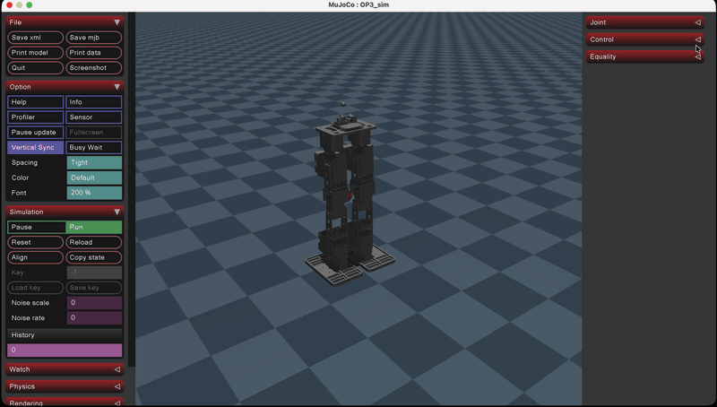
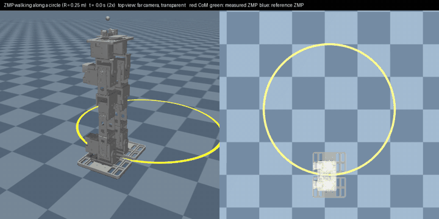

# Bipedal Robot 
A bipedal robot from scratch except actuators

### CAD

### Simulation

## Results

### Walking (ZMP) 

### Jump - the Whole-body Control with full kinematics model

It acheives 10 mm height jump.

To get higher jump, it needs actuators that have faster a angular velocity.

# Until Now

- Made a simple bipedal robot using Fusion 360.
- Spawned the robot in MuJoCo

# Next Steps
- Assemble the robot in real life. Currently, I am 3d printing.

# Challenges
- Implement a walking algorithm based on Model-based control
- Implement a walking algorithm based on Reinforcement Learning
- Jump and land <- This will be a main challenge
- Consecutive jumps <- Also a challenge
- Maybe Backflip..? <- I am not sure if the robot has enough angular velocity to do this...

# Reference
- Robotis OP3: https://github.com/robotis-git/robotis-op3

